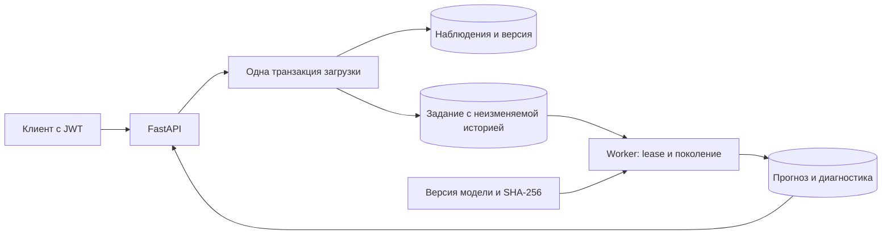

# Как устроен SupportCast

Владелец ряда проверяется при каждом чтении и изменении. Запись блокирует строку ряда, сверяет `If-Match` и обновляет данные. Все дневные значения для расчёта сохраняются в задании вместе с SHA-256, версией модели и её хешем. Изменения последующей загрузки не попадут в уже принятое задание.

Ключ идемпотентности действует внутри ряда. Хеш тела считается после сортировки дат. Повтор того же тела возвращает первый результат даже со старым `If-Match`; это позволяет восстановиться после потерянного ответа. Для новой записи заголовок обязателен: 428 при отсутствии, 412 при конфликте версии.

Worker выбирает задания через `FOR UPDATE SKIP LOCKED`. Право исполнения действует 15 секунд и имеет случайное поколение. Запись результата требует совпадения поколения и ещё действующей аренды. После падения задание может вычисляться повторно; в базе принимается результат только текущего исполнителя. Это не обещание однократного физического вычисления.

После трёх попыток задание получает `failed`. Контроль хеша обнаруживает подменённую историю или несовпадение файла модели. PostgreSQL служит и хранилищем, и очередью: отдельный брокер для этого объёма задач не нужен. Текущий worker обрабатывает по одному заданию; масштабирование проверено на конкурирующем захвате в тестах, распределённая нагрузка не измерялась.

API отдаёт статус последней версии ряда, даже если расчёт ещё не закончен. `stale` у старого задания означает, что ряд уже изменён. Клиенту следует проверять и `status`, и `stale` перед использованием прогноза.
